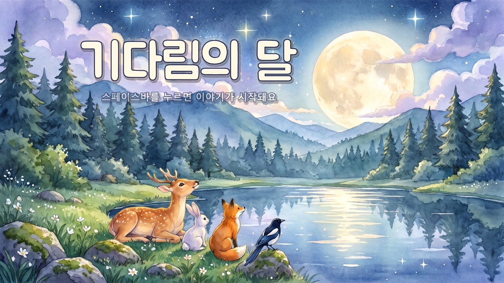

# 기다림의 달

손그림자로 이야기를 이끄는 **그림자 구연 동화 앱**입니다.
웹캠이 새·토끼·여우·사슴·달 그림자를 알아보면, 그림자가 그림 속 동물로 바뀌고 다음 장면으로 넘어갑니다.



> 구름에 가려진 달을 찾아 새는 높이 날고, 토끼는 언덕을 오르고, 여우는 숲을 뒤집니다.
> 달을 가장 먼저 본 것은 조용히 기다린 사슴이었습니다. ([전체 이야기](story.md))

## 주요 기능

- **그림자 인식:** 웹캠으로 다섯 가지 손그림자를 구별합니다.
- **자동 공연:** 17컷이 자동으로 이어지고, 그림자가 필요한 장면에서는 기다립니다.
- **자막 읽어 주기:** 미리 만든 음성으로 자막을 읽습니다.
- **AI와 대화:** 이야기가 끝난 뒤 말로 질문하면 AI가 목소리와 자막으로 답합니다 (Gemini).

## 실행

Windows와 Python 3.12에서 만들고 확인했습니다.

```powershell
git clone https://github.com/JaeSeon-Lee/vision-ai-bookstory.git
cd vision-ai-bookstory
python -m venv .venv
.venv\Scripts\python.exe -m pip install -r requirements.txt
.venv\Scripts\python.exe main.py
```

AI와 대화하려면 프로젝트 폴더에 `.env` 파일을 만들고 키를 적습니다. 키가 없어도 공연은 볼 수 있습니다.

```
GEMINI_API_KEY=발급받은_키
```

### 그림자로 공연하기

1. 스크린 뒤에 조명을 켜고, 스크린 전체가 보이게 웹캠을 고정합니다.
2. 손을 치우고 `C`를 누르면 빈 스크린을 찍고 인식을 시작합니다.
3. `Space`로 이야기를 시작하고, 스크린 뒤에서 손그림자를 비춥니다.

웹캠이 없으면 `1`~`5` 키가 그림자를 대신합니다.

| 키 | 동작 | 키 | 동작 |
|---|---|---|---|
| `Space` | 시작 · 일시정지 | `S` | 자막 읽어 주기 |
| `→` `←` | 다음 · 이전 장면 | `N` | 자막 켜기 · 끄기 |
| `1`~`5` | 새 · 토끼 · 여우 · 사슴 · 달 | `M` | 질문 녹음 (이야기가 끝난 뒤) |
| `C` | 웹캠 켜기 · 끄기 | `F` | 전체 화면 |
| `B` | 빈 스크린 다시 찍기 | `?` | 모든 단축키 보기 |

## 그림자 인식

```
웹캠 → 빈 스크린과 비교 → 그림자 윤곽 → HOG 특징 → SVM → 8프레임 중 6번 같으면 인정
```

달은 둥근 정도로 먼저 가려내고, 다섯 가지가 아닌 모양은 "없음"으로 답합니다.

| 시험 | 정답률 | 조건 |
|---|---:|---|
| 촬영 영상 | 96.0% | 학습에서 뺀 동작으로 시험. 751장에 교란 3종을 합성 |
| 실제 웹캠 | 80.1% | 시연 1회, 594프레임. 여우 98.7%, 토끼 83.7%, 새 29.5% |

서로 다른 동작이 19개뿐인 작은 데이터이고, 사슴과 달은 실제 웹캠에서 아직 재지 못했습니다.
자세한 실험과 한계는 [발표 자료](presentation/README.md)에 있습니다.

## 폴더

| 경로 | 내용 |
|---|---|
| `main.py`, `bookstory/` | 앱 (장면, 그림자 인식, 음성, AI 대화) |
| `assets/` | 그림, 음성, 글꼴, 학습된 모델 |
| `tools/` | 그림 만들기, 모델 학습과 채점 |
| `presentation/` | 발표 자료와 실험 결과 |

학습과 채점에 쓴 촬영 영상(`assets/video/`)은 공개하지 않습니다.

**사용 기술:** Python, PySide6, OpenCV, scikit-learn, Gemini API
